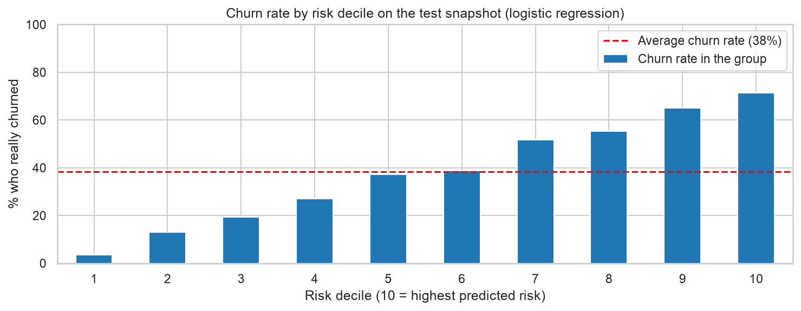
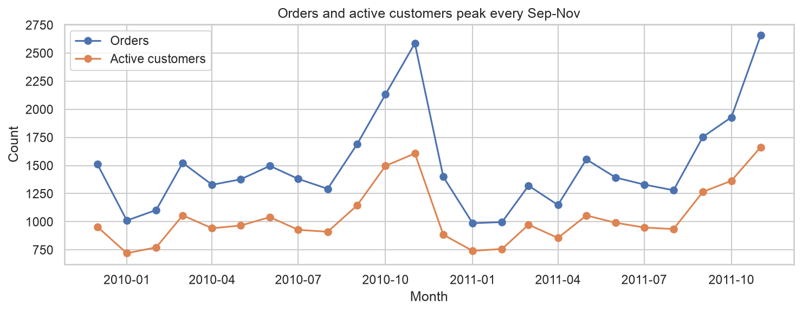
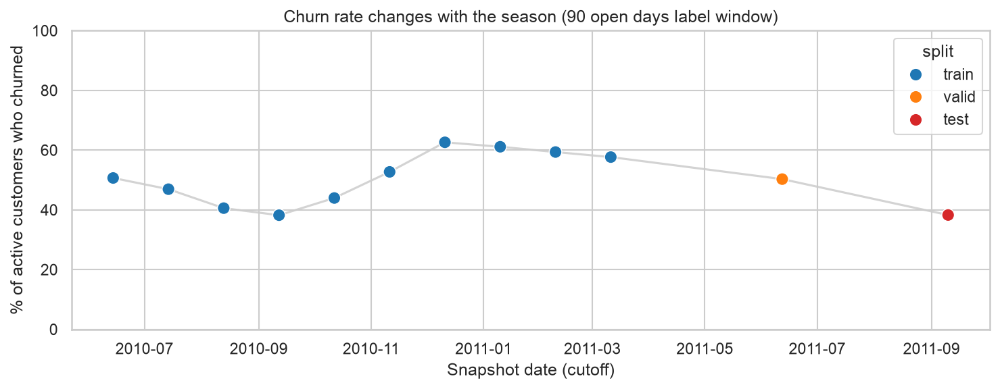

# Churn Prediction for an Online Retailer

**Which customers will not buy again in the next 90 days?** This project ranks the customers of a real UK online retailer by churn risk, so a marketing team can contact the right customers first.

On a test period the model never saw, the 10% of customers it flags as highest risk churned at **71%**, against **38%** for all customers. Contacting the top 30% of customers by risk reaches **half** of the customers who leave.



## Live demo

The model runs as a small web service (FastAPI, hosted on Render). Open the interactive page, press **POST /predict > Try it out > Execute**, and get the churn risk of a customer:

**https://churn-risk-api-0rvl.onrender.com/docs**

- **Input:** the 19 numbers that describe a customer (recency, number of invoices, spending, and so on, as built in [`04_features`](notebooks/04_features.ipynb)). An example customer is filled in. Its numbers are made up, so its score has no real meaning.
- **Output:** `churn_risk`, a number between 0 and 1. Use it to rank customers, not as an exact probability (see Limitations).
- The service runs on a free plan: if nobody used it for 15 minutes, the first request takes 30 to 60 seconds to wake it up.
- Code: [`app/main.py`](app/main.py). The trained model is saved in `models/churn_model.joblib`.

To run it on your own computer:

```bash
pip install -r requirements.txt
uvicorn app.main:app --reload
```

Then open `https://churn-risk-api-0rvl.onrender.com/docs`.

## Business problem

A retention campaign (an offer, a reminder, a call) costs money, so it should go to customers who are likely to leave. The goal is a risk score for every active customer, and a clear answer to: *how many customers should we contact, and which ones?*

## Data

[Online Retail II](https://archive.ics.uci.edu/dataset/502/online+retail+ii) (UCI Machine Learning Repository): real transactions of a UK online retailer, Dec 2009 to Dec 2011. The raw file has 1,067,371 rows. After cleaning there are **775,278 purchase lines, 36,480 invoices and 5,851 customers**.

## What I did

| Step | Notebook | What happens |
|---|---|---|
| 1. Clean | [`01_data_cleaning`](notebooks/01_data_cleaning.ipynb) | Removed the week that was in both Excel sheets, rows without a customer ID, duplicate rows, non-product rows (postage, manual entries, bank charges) and 1,318 order lines that were cancelled within one day (about £350,000, including one £168,470 order cancelled 12 minutes later). Cancellations are kept in a separate `returns` table. |
| 2. Explore | [`02_eda`](notebooks/02_eda.ipynb) | How often customers buy, how long they wait between purchases, seasonality, who brings the revenue. |
| 3. Define churn | [`03_labels`](notebooks/03_labels.ipynb) | A customer churns if they make no purchase in the next 90 days the shop was open. Only customers with a purchase in the last 180 days are scored. |
| 4. Features | [`04_features`](notebooks/04_features.ipynb) | 19 features per customer, built only from purchases before each snapshot date. |
| 5. Models | [`05_models`](notebooks/05_models.ipynb) | A simple rule, a logistic regression and LightGBM, compared on a later period. |

### How churn and the data split are defined

Churn is measured at *snapshot dates*. At each date, every customer who bought in the last 180 days is described by their past, and the label says whether they bought in the next 90 open days. The 12 snapshots are split by time, so nothing from the future leaks into the past:

- **Train:** 10 snapshots, one every 30 days (14 Jun 2010 to 11 Mar 2011), 30,885 rows
- **Valid:** 12 Jun 2011, 2,629 rows (used to compare the models)
- **Test:** 10 Sep 2011, 2,783 rows (used once, at the end)

The shop is closed for 11 days at Christmas (24 Dec to 3 Jan, both years). These days do not count towards the 90 days.

### The 19 features

| Group | Features |
|---|---|
| Recency | days since the last purchase |
| Frequency | number of invoices, number of purchase days, invoices in the last 90 and 180 days, trend (last 90 days minus the 90 days before) |
| Spending | total spent, median invoice value, spent in the last 90 and 180 days |
| Rhythm | tenure, average days between purchases, overdue ratio (recency divided by the customer's own average gap) |
| Basket | average items and lines per invoice, number of different products |
| Returns | number of return lines, return rate |
| Country | UK or not |

## What the data shows

- **Strong seasonality:** orders peak every September to November and drop in January and February.
- **Customers come back quickly:** the median gap between two purchases is 25 days, 75% of gaps are under 62 days and 90% under 136 days.
- **Many customers buy once:** 27.7% of customers bought only one time, and the typical customer has 3 orders.
- **Revenue is concentrated:** the top 10% of customers bring 63% of revenue. The UK brings 83.4%.
- **Returns are small:** 2.2% of sales value, although 40% of customers made at least one return.
- **Churn depends on the season.** Of the customers who bought in the last 180 days, 61.7% bought again within 90 days at the 15 Sep 2010 cutoff, but only 35.1% at 14 Dec 2010 and 43.2% at 14 Mar 2011.





## Results

All models learn on the train rows only. ROC-AUC measures how well a model ranks the customers who churn above the ones who stay (0.5 is guessing, 1.0 is perfect).

**Valid snapshot (June 2011):**

| Model | ROC-AUC | Churn rate in the 10% highest-risk customers |
|---|---|---|
| Recency rule (the longer silent, the higher the risk) | 0.653 | 69.8% |
| Logistic regression | 0.772 | 87.4% |
| LightGBM | 0.773 | 85.1% |

The valid churn rate is 50.3%. LightGBM was no better than the logistic regression (ROC-AUC 0.773 against 0.772), so I chose the simpler **logistic regression**.

**Test snapshot (September 2011), used once:**

| Model | ROC-AUC | Churn rate in the 10% highest-risk customers |
|---|---|---|
| Logistic regression | 0.764 | 71.2% |
| Recency rule | 0.656 | 60.1% |

The test churn rate is 38.3%. In a list of the 278 highest-risk customers, the model finds roughly 198 customers who really leave, the simple rule about 167.

**What this means for a campaign** (test snapshot):

| Contact the top ... of customers by risk | ... reaches this share of the customers who leave |
|---|---|
| 10% | 19% |
| 20% | 36% |
| 30% | 50% |
| 40% | 64% |
| 50% | 74% |

Contacting customers at random would reach 10%, 20%, 30%... of them. The lowest-risk 10% of customers churn at only 4%, so they can safely be left out.

## Limitations

- **Use the score to rank customers, not as an exact probability.** The churn rate changes with the season (from 38% in busy months to 63% in quiet months). On the test period the model predicted an average churn of 51%, while the real rate was 38%.
- **One retailer, about two years of data,** and a single test snapshot (Sep to Dec 2011).
- **The 90-day window is a business choice.** The share of customers who come back keeps rising after 90 days (43% within 90 days, 55% within 180), so some customers counted as churned come back later.
- **Orders cancelled within one day** are matched by customer, product, quantity and price, which is a rule of thumb and not an exact record.
- **The model predicts who may leave, not who would respond to an offer.** Testing offers in a real campaign is the next step.

## How to run

1. Python 3.11. Create an environment and install the packages:
   ```bash
   python -m venv .venv
   source .venv/bin/activate        # Windows: .venv\Scripts\activate
   pip install -r requirements.txt
   ```
2. Download `online_retail_II.xlsx` from the [UCI page](https://archive.ics.uci.edu/dataset/502/online+retail+ii) into `data/raw/`.
3. Run the notebooks in order, 01 to 05 (Restart and Run All in each). Notebook 01 takes a few minutes because it reads the Excel file.

## Project structure

```
churn-clv-retail/
├── app/                   # the API (main.py)
├── data/
│   ├── raw/               # the original Excel file (not in git)
│   └── processed/         # clean tables, labels, features (not in git)
├── models/                # the trained model
├── notebooks/             # 01_data_cleaning to 05_models
├── reports/figures/       # charts used in this README
├── requirements.txt
├── requirements-api.txt   # the packages the hosted API needs
└── README.md
```

## Tools

Python, pandas, scikit-learn (logistic regression, metrics), LightGBM, matplotlib and seaborn, FastAPI and Render (hosting).

## Author

**Muhammad Umar**: data science graduate, studying Business Analytics at Xamk, Finland. [LinkedIn](https://linkedin.com/in/umar43) | [GitHub](https://github.com/Umar43)
